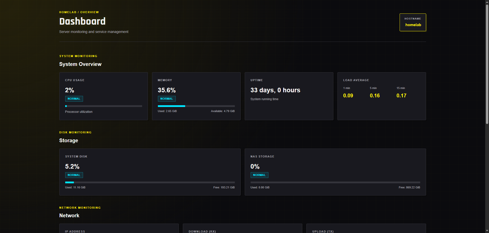
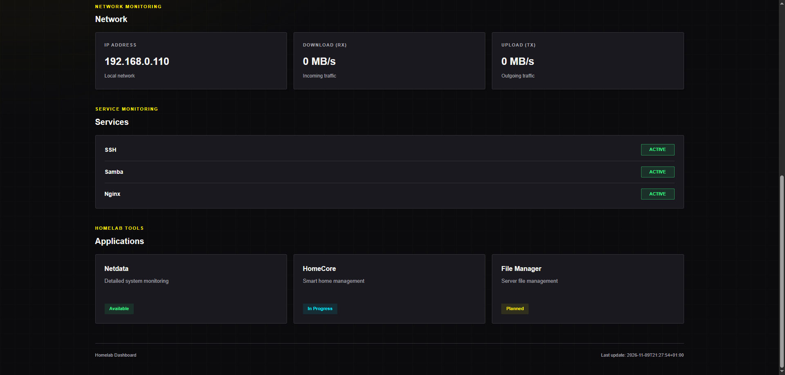

# Homelab

A personal homelab project built on Debian 13. The project combines Linux system administration, network storage, service monitoring, file management and a custom web-based system dashboard.

The main goal is to develop practical skills in Linux administration, networking, Python, web technologies, systemd and Git.

## Infrastructure

### System Environment

- Operating system: Debian 13
- Hostname: `homelab`
- Local network IP: `192.168.0.110`
- Web server: nginx
- File sharing: Samba
- System monitoring: Netdata
- File management: Cloud Commander
- Custom monitoring: Homelab Dashboard

### Storage: NAS

- Storage device: 1 TB HDD
- Partition table: GPT
- Filesystem: ext4
- Mount point: `/mnt/nas`
- Automatic mounting: `/etc/fstab`
- Mounting by UUID
- `nofail` option to prevent boot failure if the NAS disk is unavailable

### Samba NAS

- Service: `smbd`
- Share name: `Dom-Dane`
- Share path: `/mnt/nas`
- Samba user: `szymon`
- Guest access: disabled
- Write access: enabled
- `create mask`: `0660`
- `directory mask`: `0770`
- Windows access: `\\192.168.0.110\Dom-Dane`
- iOS access: SMB through the Files app
- `lost+found` hidden from SMB clients using `veto files`

**Verified functionality:**

- File transfer from Windows to NAS
- File access from NAS to Windows
- Correct permissions for newly created files and directories

## Monitoring

### Netdata

Netdata provides system-level monitoring and a detailed overview of server performance.

- Version: 2.12.0
- Dashboard: `http://192.168.0.110:19999`
- System service: `netdata.service`
- Automatic startup: enabled
- Update channel: stable
- Netdata Cloud telemetry: disabled

**Monitored areas:**

- CPU
- RAM
- Disk space
- Disk I/O
- Network traffic
- System and service metrics

### Homelab Dashboard

**Custom project**

A lightweight web-based dashboard developed to monitor the essential status and performance metrics of the homelab server.

Unlike Netdata, this dashboard is a custom-built project focused on presenting selected system information in a simple interface.

**Dashboard Overview:**



**Dashboard Details:**



**Architecture:**

```text
Debian System
    |
    v
Python Data Collection
    |
    v
JSON File
    |
    v
HTML / CSS / JavaScript
    |
    v
nginx Web Server
    |
    v
Web Browser
```

**Backend: Python**

The Python script collects system information directly from Debian system interfaces and commands.

Collected metrics include:

- CPU usage
- RAM usage
- System load average
- System uptime
- Disk usage (`/` and `/mnt/nas`)
- Network traffic (RX/TX)
- Selected system service status
- Last data update timestamp

The collected information is exported to a JSON file.

**Frontend: HTML, CSS and JavaScript**

The web interface displays:

- System hostname and uptime
- CPU and memory usage
- Storage usage
- Network traffic
- System load average
- Selected service statuses
- Last data update time

The Load Average metric represents the average number of runnable or I/O-waiting processes over 1, 5 and 15 minutes. Values should be interpreted in relation to the number of CPU cores.

The frontend retrieves data from the JSON endpoint and refreshes automatically every 30 seconds.

**Automation: systemd**

The data collection script runs automatically through a systemd service and timer.

- Service: `homelab.dashboard.service`
- Timer: `homelab.dashboard.timer`
- Execution interval: 30 seconds
- Automatic startup: enabled

**Web server: nginx**

nginx serves the static dashboard files and exposes the generated JSON data over HTTP.

### File Management: Cloud Commander

Cloud Commander provides a web-based interface for managing files and directories directly on the Debian server.

**Features:**

- Browse the server filesystem
- View and manage files and directories
- Copy and move files
- Rename and delete files
- Access the NAS and other filesystem locations subject to Unix permissions

**Architecture and configuration:**

- Application: Cloud Commander
- Version: 19.23.0
- Runtime: Node.js 24.22.2
- Application service: `cloudcmd.service`
- Application bind address: `127.0.0.1`
- Application port: `8001`
- Access path through nginx: `/files/`
- Authentication: HTTP Basic Authentication
- Application runs as the unprivileged `szymon` user
- Filesystem root: `/`
- Console and terminal access: disabled

Cloud Commander is not exposed directly to the network. nginx acts as a reverse proxy and forwards requests to the application listening on localhost.

The application runs without root privileges. File operations are therefore restricted by the permissions of the `szymon` user.

**Security considerations:**

- Authentication is required to access the application.
- Console and terminal functionality are disabled.
- The application is restricted to localhost.
- Access is intended for the local network.
- HTTP Basic Authentication over plain HTTP does not encrypt credentials in transit. HTTPS should be configured before exposing the service outside a trusted network.

Cloud Commander is available from the Applications section of the Homelab Dashboard.

## Technologies

| Area                  | Technologies             |
| --------------------- | ------------------------ |
| Operating system      | Debian 13, Linux         |
| System administration | systemd, Bash, Linux CLI |
| Storage               | GPT, ext4, fstab         |
| Network storage       | Samba, SMB               |
| Backend               | Python 3                 |
| Frontend              | HTML, CSS, JavaScript    |
| Web server            | nginx                    |
| File management       | Cloud Commander, Node.js |
| Monitoring            | Netdata                  |
| Data exchange         | JSON                     |
| Version control       | Git, GitHub              |
| Virtualization / lab  | VirtualBox               |

## Repository Structure

```text
homelab/
├── docs/
│   ├── images/
│   └── hardware.md
├── scripts/
│   └── system_info.py
├── systemd/
│   ├── cloudcmd.service
│   ├── homelab.dashboard.service
│   └── homelab.dashboard.timer
├── web/
│   ├── index.html
│   ├── style.css
│   └── script.js
├── .gitignore
└── README.md
```

## Project Status

The Debian server, NAS storage, Samba file sharing, Netdata monitoring, Homelab Dashboard v1 and Cloud Commander file management are implemented and tested.

The project is maintained as a practical learning environment for Linux administration, infrastructure management, networking and web development.
